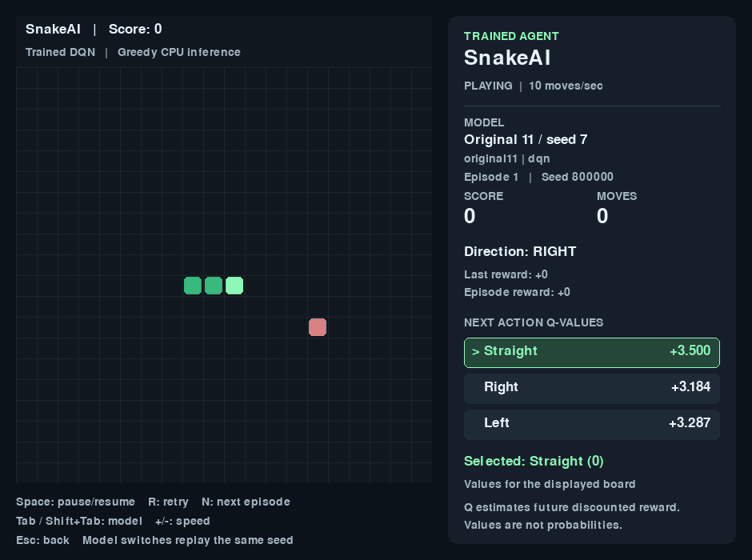
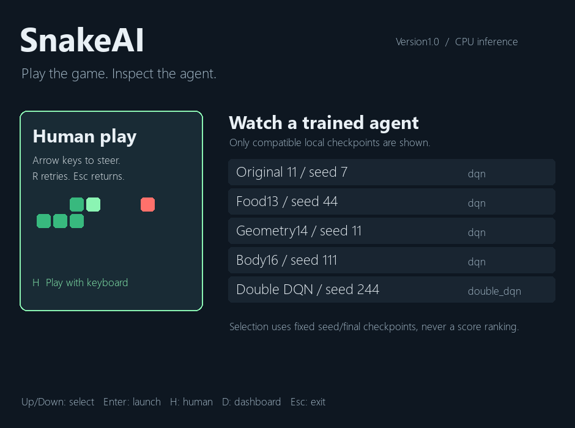
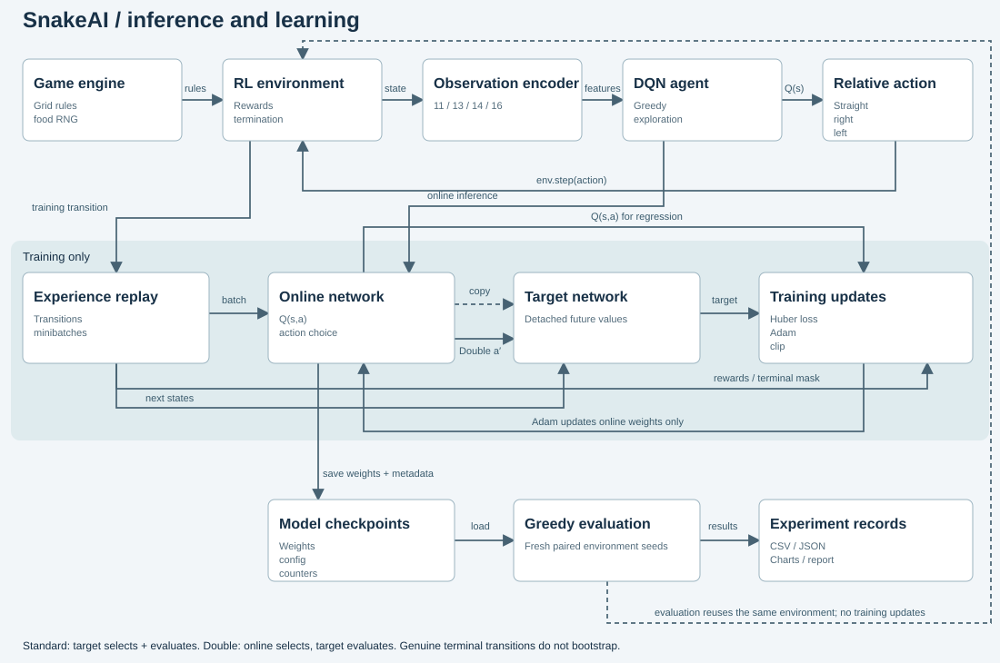

# SnakeAI

**Deep reinforcement learning, reproducible experiments, and an inspectable local demo.**

SnakeAI Version 1.0 combines a playable Python/Pygame game with a headless RL
interface, PyTorch DQN and Double DQN agents, held-out evaluation, and failure
analysis. The same game rules serve human play, training and inference.

The initial model learned to collect food, but further experiments exposed
limits: adding features or training longer did not reliably improve control.
The project preserves those negative results alongside the successful ones.



*Actual local inference, seed 800000; the first 120 moves, recorded every second
move. This clip illustrates the interface and is not a new evaluation result.*

## Measured results

The initial 11-feature model averaged **34.81 food items**, compared with
**0.14 for a random policy**, on the same 100 evaluation seeds. This was one
training seed and 500 training episodes; all evaluation games ended in collision.

Controlled comparisons below each use three independent training seeds.
Values are mean food score ? sample SD across training-seed means.
**Different studies use different seeds and budgets; this is not a universal
ranking of architectures.**

| Study | Experimental context | A | B | Mean paired B ? A |
|---|---|---:|---:|---:|
| [5D](results/milestone5d_feature_comparison/report.md) | 500 episodes or 100k moves; unequal actual experience | Original11: 29.05 ? 2.84 | Geometry14: 19.96 ? 5.77 | ?9.09 |
| [5E](results/milestone5e_food_distance/report.md) | 40k moves per independently trained model | Original11: 26.26 ? 2.23 | Food13: 30.14 ? 2.49 | +3.88 |
| [5F](results/milestone5f_body_awareness/report.md) | 40k moves per independently trained model | Food13: 29.83 ? 2.40 | Body16: 29.47 ? 3.46 | ?0.36 |
| [5G](results/milestone5g_training_duration/report.md) | Within-run 40k?100k snapshots, not separate models | Food13 at 40k: 30.00 ? 2.76 | Food13 at 100k: 30.19 ? 1.61 | +0.20 |
| [5H](results/milestone5h_double_dqn/report.md) | 100k moves; food13 for both algorithms | Standard: 25.39 ? 3.42 | Double: 25.71 ? 0.08 | +0.32 |

Food13 provided a tentative benefit in 5E, improving two of three pairs.
Body16 and longer training showed no consistent advantage. Double DQN improved
one of three pairs; its lower observed variation needs replication. None of
these small experiments establishes general superiority or statistical equivalence.

## Local demonstration

```powershell
python -m snake_ai.demo                 # Human/AI selection menu
python -m snake_ai --seed 800000        # Human play directly
python -m snake_ai.demo --model original11 --seed 800000 --speed 10
python -m snake_ai.demo --model food13 --seed 800000
python -m snake_ai.demo --list-models
```



The AI panel shows model, encoder, algorithm, episode/seed, score, moves,
direction, action, all three Q estimates, current reward, cumulative reward
and playback speed. It highlights the selected action. **Q-values estimate
future discounted reward; they are not probabilities.** No training, replay
updates or checkpoint writes occur during playback.

| Control | Human play | AI playback |
|---|---|---|
| Arrow keys | Steer | Ignored; network controls movement |
| Space | ? | Pause/resume |
| R | Restart | Replay current episode seed |
| N | ? | Next episode/seed |
| + / ? | ? | Change moves per second |
| Tab / Shift+Tab | ? | Next/previous available model |
| Esc | Return/exit | Return/exit |

Switching models resets the environment at the **same current seed** and
pauses for comparison. Each checkpoint supplies its own original environment
settings and observation encoder. Missing or incompatible catalog entries are
not offered; disappearing files produce a recoverable message. Human play
works without model weights or the optional ML dependencies.

### Demonstration checkpoints

The fixed selection rule is the historical original model, then the **first
declared training seed's final checkpoint** for each later representation or
algorithm. Selection never uses held-out scores.

| Catalog key | Encoder | Algorithm | Fixed source |
|---|---|---|---|
| `original11` | Original11 | Standard DQN | Initial seed 7 final |
| `food13` | Food13 | Standard DQN | 5E seed 44 final |
| `geometry14` | Distance14 | Standard DQN | 5D seed 11 final |
| `body16` | Body16 | Standard DQN | 5F seed 111 final |
| `double_dqn` | Food13 | Double DQN | 5H seed 244 final |

All five are available on the original development machine. **Weights are
excluded from Git**, so a clone does not include them. This keeps generated
binary artifacts out of source history; no weights have been uploaded to
Releases, LFS or third-party storage. See [exact local paths and selection
criteria](portfolio/checkpoints.md). Runtime discovery reflects actual local
availability rather than this documentation snapshot.

Supply your own compatible local checkpoint explicitly:

```powershell
python -m snake_ai.demo --checkpoint "C:modelsmy_model.pt" --seed 800000
# Existing playback entry point remains supported:
python -m snake_ai.demos.trained_ai --checkpoint "C:modelsmy_model.pt"
```

## Technology and architecture

Python 3.11+ (verified locally with 3.12.1), Pygame 2.6.1, PyTorch 2.15.0 CPU,
Matplotlib 3.11.2 and pytest. No web framework or cloud service is needed.



[Mermaid source](portfolio/architecture.mmd) ? [Local diagram generator](portfolio/build_architecture.py)

- `game/`: deterministic grid rules, isolated from rendering and ML.
- `rl/`: relative actions, configurable encoders, rewards and episode limits.
- `models/` and `agents/`: online/target networks, replay and learning targets.
- `training/`: CPU training, immutable checkpoints and greedy evaluation.
- `experiments/`: fixed protocols, paired comparisons and saved measurements.
- `demos/`, `demo.py`, `dashboard.py`: inference UI and a read-only result ledger.

## Reinforcement-learning methodology

Actions are **straight, relative right and relative left**. Rewards are +10 for
food, ?10 for collision, 0 per ordinary move, and +10 for filling the board.
Genuine terminal transitions do not bootstrap; time-limit truncations do.
Training uses experience replay, epsilon-greedy exploration, a target network,
Huber loss, Adam and gradient clipping.

Standard DQN uses the target network to select and evaluate a next action.
Double DQN selects with the online network and evaluates with the target:

```text
Standard: r + gamma * (1 - terminated) * max_a Q_target(next_state, a)
Double:   r + gamma * (1 - terminated) * Q_target(next_state, argmax_a Q_online(next_state, a))
```

Targets are detached. Standard DQN and Original11 remain defaults, preserving
legacy checkpoint configurations. Both hidden layers have 128 ReLU units and
three action-value outputs. Input modes are:

| Mode | Inputs | Definition |
|---|---:|---|
| `original11` | 11 | Three danger flags, four heading flags, four food-direction flags |
| `food13` | 13 | Original11 plus `(food_x-head_x)/(width-1)` and `(food_y-head_y)/(height-1)` |
| `distance14` | 14 | Original11 plus static free-cell distances straight/right/left, including walls and current tail |
| `body16` | 16 | Food13 plus body-only rays; tail occupied, walls excluded, no visible body returns 1 |

Distances use `max(width,height)-1` for normalisation (19 on 20?20). Food
coordinates increase right/down, so signed food offsets lie in [?1,1]. Body
rays lie in [0,1]. Their no-hit sentinel does not promise a 19-cell path or future
safety. Observations use float32.

Established settings: learning rate 0.0005, gamma 0.99, replay 50,000, batch 64,
learning starts 1,000 moves, target copy every 1,000 optimiser updates, clipping 10,
and epsilon 1?0.05 over 50,000 moves. See each saved protocol for its exact budget,
food-seed schedule, model seeds and fresh evaluation range.

## Installation

The repository is private and requires authorised GitHub access.

```powershell
git clone https://github.com/Chaytou-141/snake-ai.git
Set-Location snake-ai
py -3.12 -m venv .venv
..venvScriptsActivate.ps1
python -m pip install 'torch==2.15.0' --index-url https://download.pytorch.org/whl/cpu
python -m pip install -e '.[dev,training]'
```

Human play alone needs `python -m pip install -e .`. The optional `training`
extra supplies ML/plotting dependencies; `dev` supplies pytest. Recorded
software versions accompany each experiment. Exact reproducibility across
operating systems or library versions is not guaranteed.

## Performance dashboard

```powershell
python -m snake_ai.dashboard --open
```

This generates and opens [the local static dashboard](portfolio/dashboard/index.html).
You can also open that HTML file directly. No server, training or new evaluation
runs are started. The dashboard loads genuine saved JSON/CSV files, checks
aggregates against per-seed measurements, and reuses original Matplotlib charts.
Every comparison retains its own budget and seed context. `data.json` records
source paths and SHA-256 hashes.

## Training your own playback model

Only run training when you explicitly want new weights; missing demo models
are never silently retrained. This example creates a new Food13 model in a
fresh output directory and does not replace any historical artifact:

```powershell
python -m snake_ai.training.train --config configs/food13_example.json --output results/my_food13
python -m snake_ai.demo --checkpoint results/my_food13/checkpoints/final.pt
```

The example is for obtaining local playback weights, not a new controlled
research claim. Use a separately predefined protocol and fresh evaluation
seeds for additional research.

## Reproducing the controlled experiments

Read the recorded report/protocol/metadata before running anything. Output
paths belong to a single experiment and successful runs are reused rather
than retrained. Source/software changes are rejected when continuing an
existing frozen run. Historical reproduction should use the source version
recorded for that experiment; use a separate checkout and output directory.

| Experiment | Protocol | Runner |
|---|---|---|
| 5D | `configs/feature_comparison_v1.json` | `snake_ai.experiments.feature_comparison` |
| 5E | `configs/food_distance_v1.json` | Same feature-comparison runner |
| 5F | `configs/body_awareness_v1.json` | Same feature-comparison runner |
| 5G | `configs/training_duration_v1.json` | `snake_ai.experiments.training_duration` |
| 5H | `configs/double_dqn_v1.json` | Feature-comparison runner |

Each runner supports `--smoke`, an explicit `--output`, and `--aggregate-only`.
Feature/algorithm runners support `--model` with `--seed`; duration supports
`--seed`. For example, with the corresponding recorded source:

```powershell
python -m snake_ai.experiments.feature_comparison --protocol configs/food_distance_v1.json --output results/my_comparison --smoke
python -m snake_ai.experiments.feature_comparison --protocol configs/food_distance_v1.json --output results/my_comparison
```

These commands explicitly request new training. They were not run again for
Version 1.0. Inference checkpoints omit replay and active-game state; their
approximate-resume capability is not exact trajectory continuation. 5G kept
one agent in memory through 40k/60k/80k/100k snapshots, evaluated after training.
Snapshots are correlated repeated measurements, not independent models.

## Failure analysis and limitations

[Collision diagnostics](results/milestone5b_collision_diagnostics/report.md)
found no immediately safe action at the final move in 100/100 original-model
collisions. This does not prove that earlier decisions were optimal.
[Trap analysis](results/milestone5c_trap_analysis/report.md) examined option
counts, static reachable space and the moving-tail limitation. Static geometry
is descriptive, not a guarantee of long-term survival.

The Double DQN diagnostic measured online-target disagreement on 478 common
recorded next states. It did not measure true return-based overestimation bias.
Targets lagged by only one optimiser update at the final checkpoints.

Only three training seeds per controlled study provide preliminary evidence.
Evaluation episodes are paired conditions, not independent training
replications. No retrospective best-checkpoint selection or significance
tests were used. No study establishes universally superior features or an
algorithm; all final greedy evaluation games in 5H still ended in collision.

Future research could replicate observed variability with more independent
seeds, investigate earlier trap decisions or assess Q calibration against
returns. Version 1.0 does not start those experiments.

## Tests and portfolio assets

```powershell
python -m pytest tests/test_portfolio.py tests/test_trained_ai.py tests/test_renderer.py -q
python -m pytest -q
```

Tests cover game rules, encoders, target math, bootstrap semantics, checkpoint
compatibility, gradient isolation, reproducibility, immutable experiments,
model selection/switching, inference controls and saved-data aggregation.
Version 1.0 verification: **336 passed**, one existing dependency deprecation
warning. Details: [portfolio/verification.md](portfolio/verification.md).

- [Project summary](portfolio/project_summary.md) and [technical notes](portfolio/technical_notes.md).
- [Four LinkedIn posts](portfolio/linkedin_series.md).
- [Recording guide and suggested screenshots](portfolio/recording_guide.md).
- [Real capture provenance](portfolio/assets/capture.json) and [checkpoint inventory](portfolio/checkpoints.md).

**Portfolio summary:** SnakeAI implements and evaluates DQN-based control in a
shared, testable game environment, with reproducible comparisons, failure
analysis and an inference interface that exposes model decisions. Its findings
include tentative benefits, negative results and explicit experimental limits.
