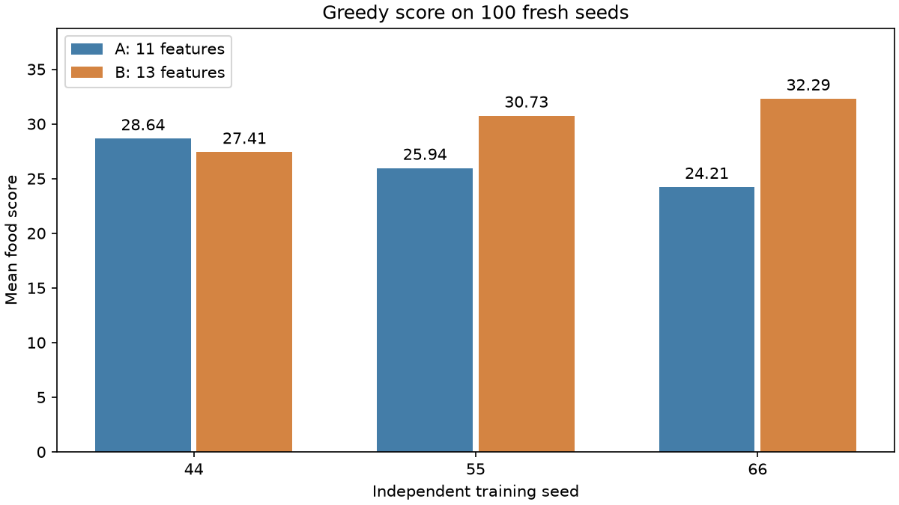
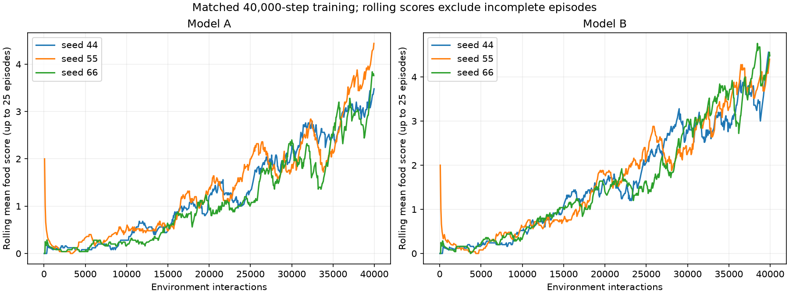
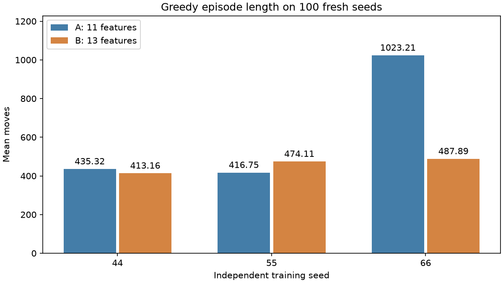

# Milestone 5E: controlled food-distance experiment

## Predeclared protocol

Primary hypothesis: adding normalised food displacement improves mean greedy food score. Secondary hypotheses: improved median score/survival and lower between-training-seed score variability. These hypotheses were frozen before training, with no tuning or checkpoint selection.

A: original11, 11 -> 128 -> 128 -> 3. B: food13, 13 -> 128 -> 128 -> 3. The first 11 features and the existing distance14 mode are unchanged. B appends dx=(food_x-head_x)/(width-1), dy=(food_y-head_y)/(height-1). Positive means right/down; float32 offsets lie in [-1,1]. Only current visible food is used; absent food yields zeros.

Training seeds 44/55/66; exactly 40,000 interactions per fresh CPU run. The existing episode loop uses a 40,000-episode safety ceiling which cannot end a run before 40,000 moves. Incomplete last episodes are excluded from completed-episode statistics. Adam 0.0005, gamma .99, batch64, replay50000, warmup1000, target every1000 optimiser updates, clip10, epsilon1 to .05 over50000 moves; rewards and termination rules unchanged.

All final checkpoints are evaluated greedily on 100 paired seeds 930000-930099. Before experiments, the user approved replacing the requested 920000 range because five of those seeds were already used by the 5D smoke test. Development smoke uses seed88 and 940000-940004 in temporary directories, separate from final findings.

## Actual run budgets and primary results

| Model | Seed | Moves | Completed episodes | Updates | Seconds | Mean score |
|---|---:|---:|---:|---:|---:|---:|
| A | 44 | 40000 | 579 | 39001 | 86.53 | 28.64 |
| B | 44 | 40000 | 588 | 39001 | 86.80 | 27.41 |
| A | 55 | 40000 | 566 | 39001 | 85.09 | 25.94 |
| B | 55 | 40000 | 582 | 39001 | 79.67 | 30.73 |
| A | 66 | 40000 | 583 | 39001 | 77.81 | 24.21 |
| B | 66 | 40000 | 572 | 39001 | 118.23 | 32.29 |

## Secondary outcomes

| Model | Seed | Median | Min | Max | Mean moves | Score SD within eval | Collision | Truncation | Win |
|---|---:|---:|---:|---:|---:|---:|---:|---:|---:|
| A | 44 | 26.00 | 8 | 62 | 435.32 | 11.78 | 100.0% | 0.0% | 0.0% |
| B | 44 | 26.50 | 6 | 61 | 413.16 | 11.30 | 100.0% | 0.0% | 0.0% |
| A | 55 | 25.00 | 8 | 51 | 416.75 | 10.09 | 100.0% | 0.0% | 0.0% |
| B | 55 | 30.00 | 8 | 59 | 474.11 | 10.44 | 100.0% | 0.0% | 0.0% |
| A | 66 | 25.50 | 0 | 55 | 1023.21 | 13.25 | 63.0% | 37.0% | 0.0% |
| B | 66 | 31.00 | 7 | 69 | 487.89 | 10.73 | 100.0% | 0.0% | 0.0% |

## Independent training-seed comparison

- A: 26.26 mean score; 2.23 sample SD across three training-seed means.
- B: 30.14 mean score; 2.49 sample SD across three training-seed means.

Paired B minus A: {'44': -1.2300000000000004, '55': 4.789999999999999, '66': 8.079999999999998}. Mean paired difference: 3.88. B outperformed A on 2/3 training seeds.

The primary hypothesis was not consistently supported across all three training seeds.

Secondary hypothesis summaries (means across the three training runs):

- A: mean of evaluation medians 25.50; mean episode length 625.09 moves.
- B: mean of evaluation medians 29.17; mean episode length 458.39 moves.

## Reproducibility and limits

Python/torch seed=s, replay=s+1, exploration=s+2; food episode seed=300000+5000*s+episode_index. Each training seed has its own disjoint possible food-seed block; A/B share initial conditions but consume randomness differently along different trajectories. Deterministic CPU algorithms and one thread are used; exact cross-platform/version reproducibility is not guaranteed. Input size changes initialisation draws; B adds 256 parameters (18,691 vs A's 18,435). Matched moves, updates and epsilon progress do not imply identical wall-clock time or replay experience.

Three independent training seeds provide exploratory evidence only. The 300 evaluation episodes per variant are not 300 independent training replications. No significance tests, tuning or best-seed selection are performed. Survival alone can reflect starvation/truncation rather than food efficiency. No universal superiority claim is justified. Future work requires a separately predeclared experiment with independent seeds; these inspected evaluation outcomes must not become tuning data.

## Artifacts and reproduction

Each runs/<model>_seed<seed>/ directory contains configuration, training CSVs/summary, ignored checkpoints, all 100 evaluation rows, and integrity hashes. Root protocol.json and metadata.json freeze methodology/software/source; per_seed_summary.csv and comparison_summary.json preserve aggregates. Earlier artifacts are preserved without regeneration.

Run focused tests, then `python -m snake_ai.experiments.feature_comparison --protocol configs/food_distance_v1.json --smoke`; remove --smoke for all final runs. Use --model A --seed 44 for an individual run, or --aggregate-only to read completed runs. Successful runs are hashed and reused, never retrained; partial failures are preserved for review. Use the recorded source version/software for historical reproduction; source drift is rejected.

## Final interpretation and validation

The overall B-minus-A mean difference was +3.88 food items, with improvements on two of three seeds. This is tentative descriptive support for an average benefit, with mixed paired results. B improved median score on all pairs, but between-training-seed variability increased (2.49 vs 2.23 sample SD), and survival was not consistently higher. A/seed66 had 37% truncations and lower food score despite much longer survival; no model recorded a win.

Focused validation: 150 tests plus one chart/report test passed. Both smoke cycles passed with 225 finite updates each. The full suite ran once: 272 passed, 0 failed, one dependency deprecation warning. Independent read-only checks verified all 600 evaluation rows, 72 saved run-artifact hashes, paired configurations/seed schedules, exact move/update budgets and aggregates. All 126 pre-existing result/checkpoint files match their pre-5E SHA-256 manifest. No successful training/evaluation runs were repeated. 5E remains uncommitted and nothing was pushed.
