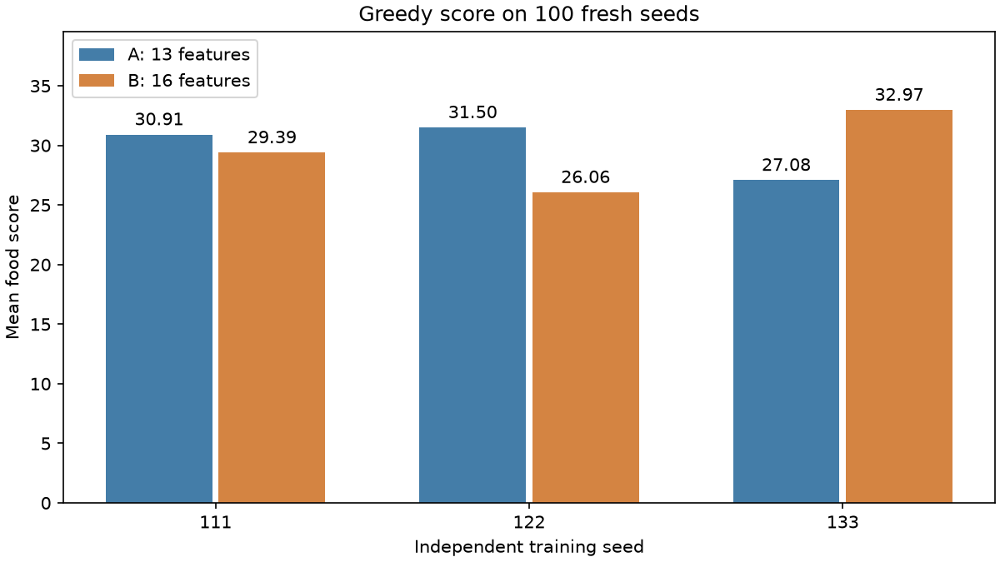
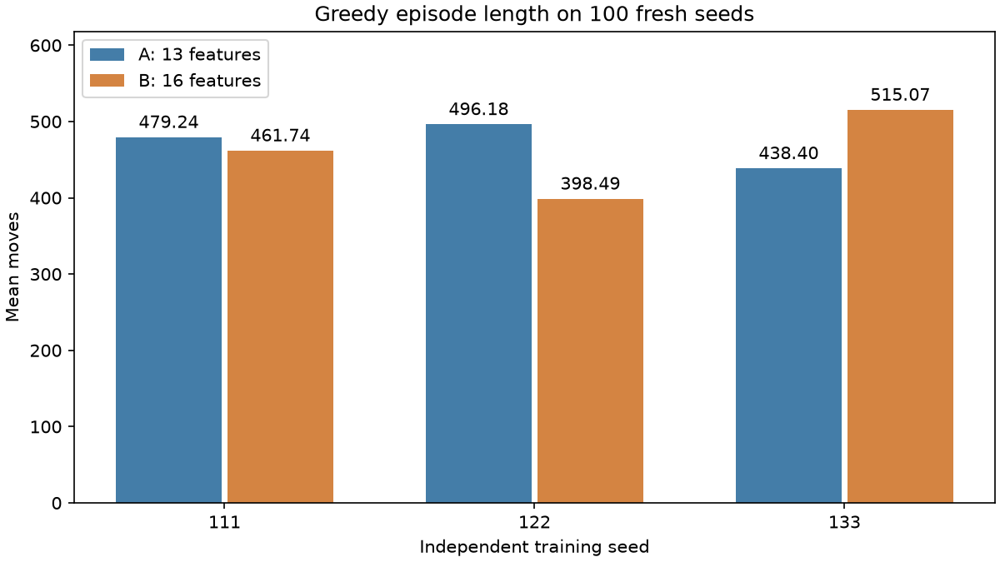

# Milestone 5F: controlled body-awareness experiment

## Frozen hypothesis and protocol

Primary hypothesis: appending three static body-distance features to food13 improves mean food score under matched training-step budgets. Secondary outcomes are median score, episode length, collision, truncation and between-training-seed variability. Improvement was not assumed.

A uses food13 (13 -> 128 -> 128 -> 3); B uses body16 (16 -> 128 -> 128 -> 3). Both are fresh models trained with seeds [111, 122, 133], exactly 40,000 moves, 39,001 updates and epsilon 0.24. All final checkpoints receive 100 greedy evaluations on seeds 950000-950099, without selection or tuning.

The first 13 features are unchanged. Body rays are straight/right/left relative to movement. For a visible body hit, count free cells before that segment, excluding the head and including the tail, then divide by max(width,height)-1 (19 on the 20x20 board). An adjacent body gives 0. If no body is visible before the boundary, return 1: a fixed maximum-range sentinel, independent of distance to the wall. Walls are not body segments. Original danger features still detect walls. All values are float32 in [0,1]. The sentinel does not mean 19 free cells physically exist along a short ray. These features measure current layout, not moving-body trajectories or guaranteed future safety.

Seed audit/amendment before training: Before training, existing results/configuration records showed model seeds77 and88 were used in 5D/5E smoke validation. User explicitly approved replacing requested77/88/99 with111/122/133. Model seeds111/122/133 and smoke155 are unused in prior experiments. Evaluation950000-950099 and smoke960000-960004 are unused; food blocks700000-739999,750000-789999,800000-839999 and smoke850000-850255 are disjoint from previous recorded/protocol smoke seeds.

Training food starts are frozen in training_seed_starts; episode_index is added within each pair. Blocks 700000,750000,800000 each allow 40000 disjoint possible episode seeds. Smoke uses model seed 155, food seeds 850000 onward and evaluation 960000-960004 in temporary directories. Smoke outcomes are technical validation only. Final evaluation and smoke ranges were checked against earlier experiment records.

CPU, one thread, deterministic algorithms where supported; Python/torch use model seed, replay seed+1, exploration seed+2. A/B share episode-food seeds but different trajectories consume randomness differently. Input-size differences also change initialisation draws. B has 384 extra input parameters (19,075 vs 18,691). Exact cross-version/platform determinism and equal wall-clock cost are not claimed.

Adam 0.0005, gamma 0.99, replay 50000, batch 64, warmup 1000, target every 1000 updates, clip 10, epsilon 1 to 0.05 over 50000 moves. Rewards, game rules and episode limits are unchanged. The existing trainer's 40000-episode safety ceiling cannot stop before 40000 moves, because every episode requires at least one move. Final incomplete episodes are logged separately and excluded from completed-episode statistics.

## Measured budgets and evaluation

| Model | Seed | Moves | Completed episodes | Updates | Seconds | Mean score | Median | Min | Max |
|---|---:|---:|---:|---:|---:|---:|---:|---:|---:|
| A | 111 | 40000 | 608 | 39001 | 86.39 | 30.91 | 31.00 | 6 | 74 |
| B | 111 | 40000 | 598 | 39001 | 89.77 | 29.39 | 29.00 | 4 | 57 |
| A | 122 | 40000 | 612 | 39001 | 90.24 | 31.50 | 30.50 | 6 | 64 |
| B | 122 | 40000 | 593 | 39001 | 104.25 | 26.06 | 24.50 | 7 | 51 |
| A | 133 | 40000 | 594 | 39001 | 86.51 | 27.08 | 28.00 | 10 | 53 |
| B | 133 | 40000 | 565 | 39001 | 90.81 | 32.97 | 33.50 | 9 | 58 |

| Model | Seed | Mean episode moves | Score SD within eval | Collision | Truncation | Win |
|---|---:|---:|---:|---:|---:|---:|
| A | 111 | 479.24 | 12.35 | 100.0% | 0.0% | 0.0% |
| B | 111 | 461.74 | 10.84 | 100.0% | 0.0% | 0.0% |
| A | 122 | 496.18 | 11.26 | 100.0% | 0.0% | 0.0% |
| B | 122 | 398.49 | 9.56 | 100.0% | 0.0% | 0.0% |
| A | 133 | 438.40 | 9.31 | 99.0% | 1.0% | 0.0% |
| B | 133 | 515.07 | 10.08 | 100.0% | 0.0% | 0.0% |

## Training-seed-level comparison

- A: 29.83 mean score; sample SD across three training-seed means 2.40.
- B: 29.47 mean score; sample SD across three training-seed means 3.46.

Paired B-minus-A differences: {'111': -1.5199999999999996, '122': -5.440000000000001, '133': 5.890000000000001}. Mean paired difference: -0.36. B was higher on 1/3 training seeds.

Three independent training seeds provide preliminary descriptive evidence only. The 100 evaluation episodes per model are not 100 independent training replications. No significance tests, hyperparameter search, best-checkpoint or best-seed selection were performed. Survival can be prolonged by truncation without efficient food collection. Static body proximity does not establish long-term planning capability; the tail moves and cells can become free. Further work needs a separately predeclared hypothesis and fresh seeds, rather than tuning on these now-inspected outcomes.

## Artifacts and reproduction

protocol.json and metadata.json freeze settings, software versions and source hashes. Each runs/<model>_seed<seed>/ directory contains training config/CSV/summary, ignored checkpoints, 100 raw evaluation outcomes and hashed completion records. Root per_seed_summary.csv and comparison_summary.json contain aggregates. Previous artifacts are preserved without regeneration.

After focused tests, run `python -m snake_ai.experiments.feature_comparison --protocol configs/body_awareness_v1.json --smoke`, then remove --smoke for final runs. Select --model/--seed for one missing run. Completed runs are verified and reused, never retrained. Incomplete failures are preserved for review; source/software changes are rejected. Use --aggregate-only to read completed runs without training. For historical reproduction, use the corresponding recorded source/software versions.

## Interpretation and final validation

A averaged 29.83 (sample SD 2.40 across training-seed means), B 29.47 (SD 3.46). The mean paired difference was -0.36 food items. Body16 was higher on only one of three seeds: these data do not support consistent improvement under this protocol. They do not establish universal harm or statistical equivalence. Median scores and survival favoured B only on seed133. A/seed133 had one truncation; all other episodes ended in collision and no model won. No claim of improved long-term planning is justified.

All 23 new focused tests passed, and relevant existing checks passed. Both technical smoke cycles completed 225 finite updates per model, loaded checkpoints successfully, and preserved weights during evaluation. The full suite ran once at completion: 295 passed, 0 failed, one dependency deprecation warning. Independent read-only checks reproduced metrics from all 600 evaluation rows, verified 74 run-artifact hashes, exact matched budgets and seed schedules, and confirmed all 213 historical files unchanged against pre-5F SHA-256 hashes. No successful training/evaluation runs were repeated and no earlier experiments were regenerated. 5F remains uncommitted; nothing was pushed during this milestone.
