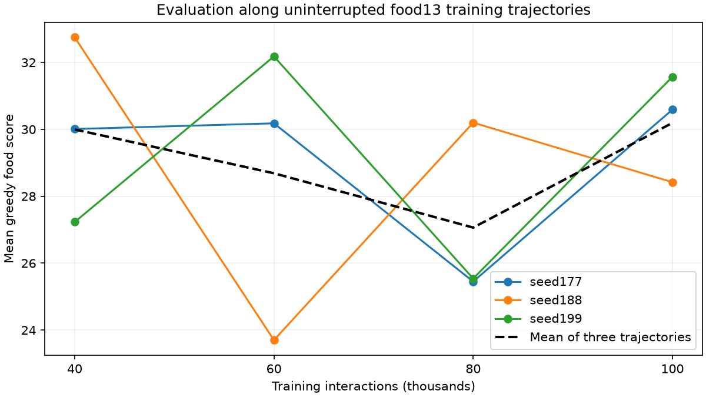
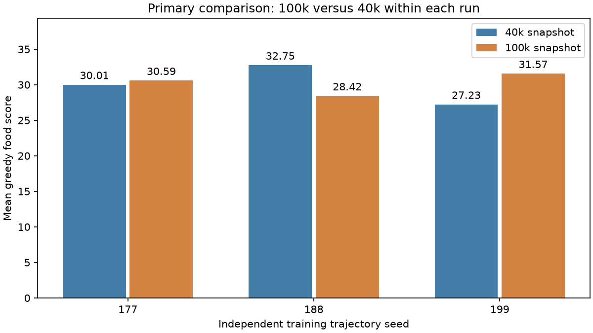

# Milestone 5G: food13 training duration

## Frozen within-run protocol

Does food13 benefit from additional training along the same uninterrupted trajectory?
Mean greedy food score at100000 moves exceeds the paired40000-move snapshot across three independent training trajectories; improvement is not assumed.

Three fresh independent food13 trajectories, seeds 177/188/199, run continuously to 100,000 moves. Snapshots at 40k/60k/80k/100k are post-update copies; no replay reset, episode truncation, RNG draw or evaluation is inserted into training. All snapshots are evaluated only after their 100k trajectory finishes. The 40k snapshot is not a separately trained 40k-budget model. The primary endpoint is 100k minus 40k; intermediate measurements are descriptive and never select a best model.

Food13 and 13->128->128->3, rewards, game rules and standard DQN are unchanged. Adam .0005, gamma .99, replay 50000, batch 64, learning starts 1000, target every 1000 optimizer updates, clip 10, epsilon 1 to .05 over 50000 moves. Epsilon is .24 at 40k and .05 at 60k/80k/100k. This tests additional training under the unchanged schedule, not duration independently of exploration.

CPU one thread, deterministic algorithms where supported. Python/torch seed=s, replay=s+1, exploration=s+2. Food starts 1100000/1200000/1300000 plus episode index. Greedy evaluation uses identical fresh seeds 1500000-1500099 for every snapshot. Smoke uses seed 211, food 1410000 onward and evaluation 1600000-1600004 in temporary directories. Prior seed records were audited before freezing these ranges. Exact cross-platform/version determinism is not guaranteed.

## Measured results

| Seed | Moves | Completed episodes | Updates | Epsilon | Elapsed seconds | Mean | Median | Min | Max | Mean episode moves | Collision | Truncation |
|---|---:|---:|---:|---:|---:|---:|---:|---:|---:|---:|---:|---:|
| 177 | 40000 | 575 | 39001 | 0.24 | 75.83 | 30.01 | 29.00 | 10 | 56 | 447.71 | 100.0% | 0.0% |
| 177 | 60000 | 705 | 59001 | 0.05 | 123.17 | 30.18 | 30.00 | 2 | 57 | 471.95 | 100.0% | 0.0% |
| 177 | 80000 | 796 | 79001 | 0.05 | 172.45 | 25.45 | 24.00 | 2 | 50 | 379.74 | 100.0% | 0.0% |
| 177 | 100000 | 880 | 99001 | 0.05 | 221.76 | 30.59 | 30.50 | 7 | 66 | 465.27 | 100.0% | 0.0% |
| 188 | 40000 | 580 | 39001 | 0.24 | 77.97 | 32.75 | 32.00 | 10 | 63 | 495.24 | 100.0% | 0.0% |
| 188 | 60000 | 695 | 59001 | 0.05 | 125.03 | 23.70 | 23.00 | 4 | 49 | 341.78 | 100.0% | 0.0% |
| 188 | 80000 | 792 | 79001 | 0.05 | 173.67 | 30.20 | 30.50 | 4 | 63 | 455.88 | 100.0% | 0.0% |
| 188 | 100000 | 880 | 99001 | 0.05 | 222.87 | 28.42 | 29.00 | 4 | 65 | 422.54 | 100.0% | 0.0% |
| 199 | 40000 | 613 | 39001 | 0.24 | 76.85 | 27.23 | 27.00 | 8 | 51 | 400.68 | 100.0% | 0.0% |
| 199 | 60000 | 739 | 59001 | 0.05 | 123.69 | 32.18 | 30.00 | 6 | 71 | 504.11 | 100.0% | 0.0% |
| 199 | 80000 | 826 | 79001 | 0.05 | 173.02 | 25.54 | 24.50 | 7 | 62 | 380.76 | 100.0% | 0.0% |
| 199 | 100000 | 915 | 99001 | 0.05 | 221.30 | 31.57 | 30.50 | 9 | 61 | 480.82 | 100.0% | 0.0% |

## Independent-trajectory comparison

- 40k: mean 30.00; sample SD across three trajectory means 2.76.
- 60k: mean 28.69; sample SD across three trajectory means 4.43.
- 80k: mean 27.06; sample SD across three trajectory means 2.72.
- 100k: mean 30.19; sample SD across three trajectory means 1.61.

Primary paired 100k-minus-40k differences: {'177': 0.5799999999999983, '188': -4.329999999999998, '199': 4.34}. Mean 0.20; improved on 2/3 trajectories.

Three trajectories provide preliminary evidence. Four snapshots from a run are correlated repeated measurements, not four independent training runs. The 100 paired evaluation episodes do not create 100 independent training replications. No significance tests, tuning, stopping based on evaluation or retrospective best-checkpoint selection are performed. A higher intermediate score does not replace the predefined 100k endpoint. Improvement need not be monotonic, and longer survival can reflect truncation rather than food collection. Fixed snapshots are for evaluation, not exact resume: existing checkpoint files do not store active-game/replay state; training remains in memory throughout.

## Artifacts and reproduction

protocol.json and metadata.json freeze settings/source/software. Each runs/seed*/training directory has metrics, configurations and ignored checkpoints; evaluations contains 100 raw outcomes per snapshot. Completion records hash all run files; root per_snapshot_summary.csv and comparison_summary.json store measured aggregates. Previous experiments/checkpoints are preserved without regeneration.

`python -m snake_ai.experiments.training_duration --smoke` validates temporary development training. Run the module without --smoke for all three trajectories, --seed 177 for one missing trajectory or --aggregate-only to read successful records. Successful runs are reused without training. Partial failures are preserved for review and are not approximately resumed.

## Interpretation and final validation

The primary mean changed from 29.9967 at 40k to 30.1933 at 100k. Paired changes were +0.58, -4.33, +4.34, averaging +0.1967 (sample SD 4.3477), positive on 2/3 trajectories. This small observed average gain with mixed directions does not demonstrate reliable substantial improvement, establish equivalence, or rule out benefits in other settings. Intermediate scores were non-monotonic. All 1,200 evaluation episodes ended in collision; no truncations or wins were recorded. No intermediate checkpoint replaced the predefined 100k endpoint.

93 focused tests passed, including 13 new duration tests. Direct tests compared training with/without snapshot saving, checking identical weights, optimizer state, replay contents/sampling RNG, exploration RNG, game state and logs. Technical smoke completed 512 moves, 481 finite updates, four loaded snapshots and 20 greedy evaluation episodes with unchanged weights; temporary files were cleaned. The full suite ran once at completion: 308 passed, 0 failed, one dependency deprecation warning. Independent read-only verification checked all 1,200 raw evaluation rows, 76 run-artifact hashes, snapshot progress/tensors, seed schedules, budgets and aggregates. All 301 historical artifact files remain byte-for-byte unchanged. Exactly three 100k trajectories were trained once; no prior experiments were regenerated. 5F was committed/pushed before development as 79540213e5a8500e83384fd256122fe57e4e46ac; 5G remains uncommitted for review and no further push occurred.
