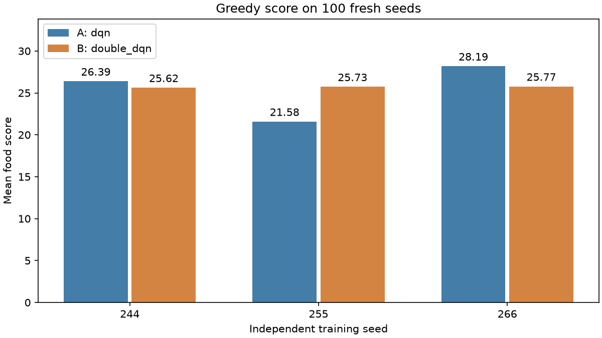

# Milestone 5H: Standard DQN versus Double DQN

## Frozen protocol

Primary hypothesis: Double DQN improves mean greedy food score; benefit is not assumed. A is Standard DQN; B is Double DQN. Both use unchanged food13, 13 -> 128 -> 128 -> 3, rewards, game rules and episode limits. For each seed, initial online/target weights, replay/exploration seeds and paired food-episode schedules match. Only next-state action selection in the learning target differs.

Standard target: reward + gamma*(1-terminated)*max_a Q_target(next_state,a). Double target: reward + gamma*(1-terminated)*Q_target(next_state,argmax_a Q_online(next_state,a)). Targets are detached; genuine terminal transitions do not bootstrap; time-limit truncations retain the existing bootstrap semantics. Standard DQN remains the default; old checkpoint configs load as dqn.

Seed amendment before training: Requested model seed211 was used in5G smoke. Under the authorised no-overlap rule, freeze unused244/255/266 for training and288 for smoke. Audit eval970000-970099, smoke980000-980004 and all new food blocks against earlier recorded seeds before training.

Six fresh CPU runs, 100,000 moves each, paired seeds 244/255/266. Food blocks start 110000/300000/400000 and add episode index; ranges were audited before training. Final greedy evaluations use identical fresh seeds 970000-970099. Smoke uses model seed 288, food 600000 onward and evaluation 980000-980004 in temporary directories, separate from scientific findings.

Adam 0.0005, gamma 0.99, replay 50000, batch 64, learning starts 1000, target every 1000 optimizer updates, clip 10, epsilon 1 to 0.05 over 50000 moves. One CPU thread, deterministic algorithms where supported; Python/torch seed=s, replay=s+1, exploration=s+2. Matched initializations do not make later experiences identical. Exact cross-platform/software reproducibility is not guaranteed.

## Actual budgets and evaluation

| Model | Seed | Moves | Completed episodes | Updates | Seconds | Mean | Median | Min | Max | Mean episode moves | Collision | Truncation | Win |
|---|---:|---:|---:|---:|---:|---:|---:|---:|---:|---:|---:|---:|---:|
| A | 244 | 100000 | 888 | 99001 | 221.45 | 26.39 | 28.00 | 3 | 46 | 398.42 | 100.0% | 0.0% | 0.0% |
| B | 244 | 100000 | 939 | 99001 | 231.93 | 25.62 | 25.00 | 2 | 51 | 392.44 | 100.0% | 0.0% | 0.0% |
| A | 255 | 100000 | 905 | 99001 | 226.91 | 21.58 | 19.50 | 4 | 51 | 324.46 | 100.0% | 0.0% | 0.0% |
| B | 255 | 100000 | 892 | 99001 | 238.70 | 25.73 | 25.00 | 4 | 52 | 391.28 | 100.0% | 0.0% | 0.0% |
| A | 266 | 100000 | 891 | 99001 | 225.49 | 28.19 | 27.00 | 8 | 60 | 427.50 | 100.0% | 0.0% | 0.0% |
| B | 266 | 100000 | 860 | 99001 | 235.99 | 25.77 | 25.00 | 6 | 60 | 390.31 | 100.0% | 0.0% | 0.0% |

## Independent training-seed comparison

- A: 25.39 mean score; sample SD across seed means 3.42.
- B: 25.71 mean score; sample SD across seed means 0.08.

Double-minus-Standard differences: {'244': -0.7699999999999996, '255': 4.150000000000002, '266': -2.4200000000000017}. Mean paired difference 0.32; Double higher on 1/3 seeds.

## Descriptive training stability

| Model | Seed | Mean loss | Max loss | Last 10k mean loss | Last 10k loss SD | Gradient clipping fraction |
|---|---:|---:|---:|---:|---:|---:|
| A | 244 | 0.16816 | 2.03771 | 0.31954 | 0.23120 | 0.1% |
| B | 244 | 0.17337 | 2.19587 | 0.33480 | 0.24258 | 0.0% |
| A | 255 | 0.18012 | 2.77032 | 0.36114 | 0.26349 | 0.1% |
| B | 255 | 0.17098 | 2.17606 | 0.32712 | 0.21698 | 0.0% |
| A | 266 | 0.16701 | 2.17004 | 0.32637 | 0.22965 | 0.1% |
| B | 266 | 0.17227 | 2.13435 | 0.33320 | 0.23345 | 0.1% |

Loss and clipping are descriptive: policies experience different data and target scales. Lower loss alone does not establish better control or general training stability.

## Q-estimator disagreement diagnostic

A common pool of 478 nonterminal next states was recorded during the required evaluations: first 20 episodes, moves 1/10/25/50, at most 80 per agent. The union from all six policies is fed unchanged to every final estimator. No additional environment runs are used.

| Model | Seed | Mean signed gap | Mean absolute gap | Gap SD | Target lag (updates) |
|---|---:|---:|---:|---:|---:|
| A | 244 | 0.129721 | 0.129721 | 0.080535 | 1 |
| B | 244 | 0.230434 | 0.230434 | 0.036191 | 1 |
| A | 255 | 0.157684 | 0.157684 | 0.051765 | 1 |
| B | 255 | 0.027739 | 0.044881 | 0.044826 | 1 |
| A | 266 | 0.039531 | 0.043648 | 0.033477 | 1 |
| B | 266 | 0.094208 | 0.094208 | 0.027273 | 1 |

Same pooled next states from both algorithms and all three seeds. Signed estimator disagreement, not actual overestimation: no ground-truth returns measured. Pool is policy-dependent and nonuniform. Targets lag by one optimizer update at final checkpoints; small gaps can reflect recent synchronization and do not prove calibrated Q values.

Three training seeds are preliminary evidence. The 300 evaluation episodes per algorithm are not 300 independent training replications; no significance tests, hyperparameter search or best-checkpoint selection are performed. Diagnostic states are correlated and policy-dependent, and no true return-based Q calibration was measured. Further investigation needs separately predefined settings and fresh evaluation seeds rather than tuning on these outcomes.

## Artifacts and reproduction

protocol.json/metadata.json freeze settings/source/software. runs/<model>_seed<seed>/ contains training config/CSV/summary, ignored checkpoints, 100 raw evaluation outcomes, captured next states and hashed completion records. Root per_seed_summary.csv and comparison_summary.json report outcomes. diagnostic_states.csv, q_disagreement.csv and diagnostic_summary.json preserve the common pool, per-state values and summary hashes. All older artifacts remain unchanged.

`python -m snake_ai.experiments.feature_comparison --protocol configs/double_dqn_v1.json --smoke`; remove --smoke for all six runs, or select --model/--seed for one missing run. Completed runs are verified/reused without retraining; incomplete failures are preserved for review. --aggregate-only reads completed files; use recorded source/software for historical reproduction.

## Interpretation and final validation

Standard averaged 25.3867 (sample SD 3.4173 across training-seed means), Double 25.7067 (SD 0.0777). Paired Double-minus-Standard differences were -0.77, +4.15, -2.42, averaging +0.32; Double was higher on 1/3 seeds. This small observed average benefit with mixed directions does not establish consistent superiority. Lower observed between-seed variability warrants a separately predefined replication, rather than treating Double as a proven upgrade. All 600 greedy evaluation episodes ended in collision.

The common diagnostic pool contained 478 states. Across training-seed means, signed estimator gaps were 0.10898 (Standard) and 0.11746 (Double); absolute gaps 0.11035 and 0.12317. Double reduced absolute disagreement only on seed 255. This is not consistent disagreement reduction or proof of actual overestimation bias: true returns were not measured, states are policy-dependent and final targets lag by one update. All agents received exactly the same pool, with no additional environment evaluations.

Focused validation: 85 tests plus one chart/report test passed, including 16 new algorithm tests. Both temporary smoke cycles completed 512 moves and 481 finite updates, loaded the correct algorithms and preserved weights during evaluation. The full suite ran once at completion: 324 passed, 0 failed, one dependency deprecation warning. An independent read-only audit checked all 600 evaluation records,98 run-artifact hashes, exact 100k budgets/99001 updates, paired configurations, loss/clipping summaries, common diagnostic records and aggregates. All 388 historical files remain byte-for-byte unchanged, with no successful training/evaluation repeated. 5G was verified, committed and pushed first as aad03f19f589d9883e34b0c5d81780872b26cba9. 5H remains uncommitted and was not pushed. Standard DQN remains the default; no further milestone was started.
